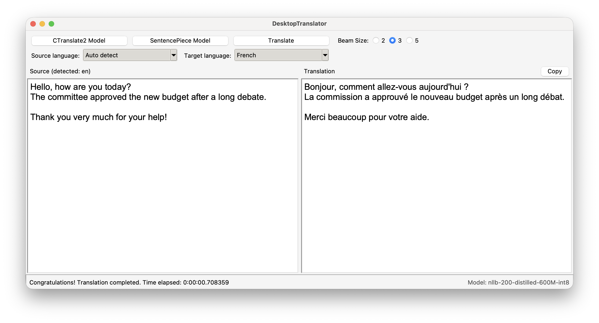

[](https://github.com/ymoslem/DesktopTranslator/releases/download/v0.4.0/DesktopTranslator_Windows_0.4.0.exe)
[](https://github.com/ymoslem/DesktopTranslator/releases/download/v0.4.0/DesktopTranslator_macOS_0.4.0.zip)

# DesktopTranslator
Local cross-platform machine translation app, based on [CTranslate2](https://github.com/OpenNMT/CTranslate2). Your text stays on your computer.



**Table of contents**

1. [Download DesktopTranslator](#download-desktoptranslator)
1. [Using DesktopTranslator](#using-desktoptranslator)
1. [Run from Source](#run-from-source)
1. [Translation Models](#translation-models)
    * [French-to-English Generic Model](#french-to-english-generic-model)
    * [M2M-100 Multilingual Model](#m2m-100-multilingual-model)
    * [NLLB-200 Multilingual Model](#nllb-200-multilingual-model)
1. [[Optional] Build Stand-alone Executable](#build-stand-alone-executable)
   * [Build Windows Installer](#build-windows-installer)
   * [Build macOS App](#build-macos-app)
1. [Licenses](#licenses)
1. [References](#references)

    
## Download DesktopTranslator
   
[](https://github.com/ymoslem/DesktopTranslator/releases/download/v0.4.0/DesktopTranslator_Windows_0.4.0.exe)
[](https://github.com/ymoslem/DesktopTranslator/releases/download/v0.4.0/DesktopTranslator_macOS_0.4.0.zip)


The installers are not signed. On macOS (Apple Silicon), open **System Settings** > **Privacy & Security** and click **Open Anyway** the first time you launch the app. On Windows, SmartScreen may show a warning; click **More info** > **Run anyway**.


## Using DesktopTranslator

1. Choose <kbd>Translate</kbd> menu \> <kbd>Open Model...</kbd> (<kbd>Ctrl</kbd>/<kbd>Cmd</kbd> + <kbd>M</kbd>) and select the folder of a [translation model](#translation-models). The SentencePiece model is found in the same folder; if there are several, you are asked which one to use.
2. For a multilingual model, select the target language. The source language is detected, and the Source header shows it with the number of words. To choose the source language yourself, use the <kbd>From</kbd> list. The <kbd>⇄</kbd> button swaps the two languages.
3. Type or paste text on the left, or open a file with <kbd>File</kbd> menu \> <kbd>Open Text...</kbd> (plain text files only; use <kbd>Reopen Text with Encoding...</kbd> if the characters look wrong). You can also drop a text file on the source pane.
4. Click <kbd>Translate</kbd>. The translation appears as it is made, with the time left, and you can click <kbd>Cancel</kbd> to stop; the part that is done is kept. Use <kbd>Copy</kbd> or <kbd>File</kbd> menu \> <kbd>Save Translation...</kbd> when it is finished.

Right-to-left languages such as Arabic, Persian, Urdu, and Hebrew are displayed and edited right to left, and the app follows the dark mode of your system. Use the <kbd>View</kbd> menu to change the text size.

**Preferences** (<kbd>Edit</kbd> menu \> <kbd>Preferences...</kbd>)

| Option | Effect |
|---|---|
| Translation quality | Fast (beam size 2), Balanced (3, the default), or Accurate (5, slower and sometimes better) |
| Avoid repeated words | A repetition penalty of 1.2, off by default because translations scored higher without it in tests (`tests/repetition_penalty_eval.py`) |
| Join lines inside a paragraph | For text from PDF files or OCR, where lines break in the middle of a sentence |
| Remember the last model and target language | Opens the same model the next time |

**Long texts.** The text area accepts up to 20,000 words. For a longer text, use <kbd>File</kbd> menu \> <kbd>Translate Document...</kbd> (<kbd>Ctrl</kbd>/<kbd>Cmd</kbd> + <kbd>Shift</kbd> + <kbd>O</kbd>), which translates a plain text file into another file in the background, with progress and the time left. If you cancel, the translated part is saved. PDF and Word files are not supported; save them as plain text first.

Each sentence is translated on its own, and a sentence that repeats is translated once and reused, so it is translated the same way everywhere.

**Memory.** Larger models need more memory. The app warns you if the computer may not have enough free memory for the model you open.


## Run from Source

You need Python 3.11 or later.
```
git clone https://github.com/ymoslem/DesktopTranslator.git
cd DesktopTranslator
python3 -m venv .venv
source .venv/bin/activate
pip install -r requirements.txt
python qt_app.py
```
On Windows, activate the virtual environment with `.venv\Scripts\activate`.


## Translation Models

DesktopTranslator supports CTranslate2 models with their SentencePiece subwording models (you need both). If you have a model for OpenNMT-py, OpenNMT-tf, or FairSeq, you can [convert it to the CTranslate2 format](https://github.com/OpenNMT/CTranslate2#quickstart).

### French-to-English Generic Model

If you would like to try out the app and you do not have a model, you can download my [French-to-English generic model here](https://github.com/ymoslem/DesktopTranslator/releases/download/v0.2.3/fren.zip). 
1. Unzip the `fren.zip` archive of the French-to-English generic model you just downloaded. It has two folders, `ct2_model` for the CTranslate2 model and `sp_model` for the SentencePiece subwording models of French (source) and English (target).
2. In DesktopTranslator, click the <kbd>Open Model...</kbd> button, and select the `ct2_model` folder.
3. When you are asked for the SentencePiece model, navigate to the `sp_model` folder, and select `fr.model`.
4. In the left text area, type some text in French or use the <kbd>File</kbd> menu \> <kbd>Open Text...</kbd> to open a *.txt file.
5. Click the <kbd>Translate</kbd> button. The default translation quality is "Balanced"; you can change it in the Preferences.

### M2M-100 Multilingual Model

Now, DesktopTranslator supports [**M2M-100**](https://github.com/pytorch/fairseq/tree/main/examples/m2m_100) ([Fan et al., 2020](https://arxiv.org/abs/2010.11125)), a multilingual model that can translate between 100 languages.
    
To use M2M-100 models in DesktopTranslator, please follow these steps:
1. Download one of the M2M-100 models, converted to the CTranslate2 format:  
    a. [M2M-100 418M-parameter model](https://github.com/ymoslem/DesktopTranslator/releases/download/v0.2.1/M2M-100_418m_parameter_model_ct2.zip); smaller and faster, but sometimes less accurate; or  
    b. [M2M-100 1.2B-parameter model](https://github.com/ymoslem/DesktopTranslator/releases/download/v0.2.1/M2M-100_12b_parameter_model_ct2.zip); bigger and somehow slower, but sometimes more accurate.
2. Extract the *.zip arhieve of the model you downloaded.
3. In DesktopTranslator, click the <kbd>Open Model...</kbd> button, and select the `m2m100_418m` or `m2m100_12b` folder. Its `sentencepiece.model` is used automatically.
4. From the <kbd>To</kbd> list, select the language to which you want to translate. The source language is detected, or you can select it in the <kbd>From</kbd> list.
5. In the left text area, type some text in any language or use the <kbd>File</kbd> menu \> <kbd>Open Text...</kbd> to open a *.txt file.
6. Click the <kbd>Translate</kbd> button.
   
### NLLB-200 Multilingual Model

DesktopTranslator also supports [**NLLB-200**](https://arxiv.org/abs/2207.04672) ([NLLB Team et al., 2022](https://arxiv.org/abs/2207.04672)), a multilingual model that can translate between 200 languages. Note that Meta released the NLLB-200 models under the [CC-BY-NC 4.0](https://creativecommons.org/licenses/by-nc/4.0/) license, which does not allow commercial use. To use them, please follow these steps:
1. Download one of the NLLB-200 models, converted to the CTranslate2 format with int8 quantization:  
    a. [NLLB-200 distilled 600M-parameter model](https://github.com/ymoslem/DesktopTranslator/releases/download/v0.3.0/NLLB-200_distilled_600M_int8_ct2.zip); the smallest and fastest, and good for most uses. You can also use the <kbd>Help</kbd> menu \> <kbd>Get Models...</kbd>; or  
    b. [NLLB-200 distilled 1.3B-parameter model](https://github.com/ymoslem/DesktopTranslator/releases/download/v0.3.0/NLLB-200_distilled_1.3B_int8_ct2.zip); slower and needs more memory, but sometimes more accurate; or  
    c. [NLLB-200 3.3B-parameter model](https://pretrained-nmt-models.s3.us-west-004.backblazeb2.com/CTranslate2/nllb/nllb-200_3.3B_int8_ct2.zip) (3.1 GB); the largest, slowest, and needs the most memory. This archive does not include a SentencePiece model, so also download [NLLB-200_sentencepiece.model](https://github.com/ymoslem/DesktopTranslator/releases/download/v0.3.0/NLLB-200_sentencepiece.model).
2. Extract the *.zip archive.
3. In DesktopTranslator, click the <kbd>Open Model...</kbd> button, and select the model folder, for example `nllb-200-distilled-600M-int8`. Its `sentencepiece.model` is used automatically. For the 3.3B model, when you are asked, select the `NLLB-200_sentencepiece.model` file you downloaded.
4. From the <kbd>To</kbd> list, select the language to which you want to translate. You can type to search the list. Language varieties are grouped, for example "Arabic (Modern Standard)" and "Arabic (Egyptian)". The source language is detected automatically; to choose it yourself, use the <kbd>From</kbd> list.
5. Click the <kbd>Translate</kbd> button. You can click <kbd>Cancel</kbd> to stop a long translation.

### OPUS Models

OPUS models ([Tatoeba-Challenge](https://github.com/Helsinki-NLP/Tatoeba-Challenge/tree/master/models)) can be used and they can be more efficient. As of now, only _bilingual_ models are supported by DesktopTranslator. Note: You must convert an OPUS model to the CTranslate2 format first. Example command:
```
ct2-opus-mt-converter --model_dir opus_model_dir --output_dir ct2_model_dir --quantization int8
```
The source and target tokenization SentencePiece models can be found in the same archive of the downloaded model.

## [Optional] Build Stand-alone Executable

The installers are built automatically with the [GitHub Actions workflow](.github/workflows/build.yml), which uses PyInstaller on both platforms, and [installer.nsi](installer.nsi) for the Windows installer. To build them yourself, you can follow the steps below.
   
### Build Windows Installer

If you want to adjust the code and then build an installer yourself, you can follow these steps:

1. Install the requirements and PyInstaller, preferably in a virtual environment.
```
pip3 install -r requirements.txt pyinstaller==6.22.3
```

2. Run PyInstaller. The data folders and the `--collect-data` options are needed, otherwise some languages, such as Turkish, fail to be split into sentences.
```
pyinstaller -y --windowed --name DesktopTranslator --add-data "utils;utils" --add-data "img/icon.png;img" --add-data "NOTICE.md;." --icon img/icon.png --collect-data sentence_splitter --collect-data pysbd --collect-all ctranslate2 qt_app.py
```
3. Try the `*.exe` file under "dist\DesktopTranslator" to make sure it works.
4. Download and install [NSIS](https://nsis.sourceforge.io/Download), and then create the installer with the script [installer.nsi](installer.nsi). It installs the app to "Program Files", and adds Start menu and Desktop shortcuts and an uninstaller.
```
makensis /DVERSION=0.4.0 installer.nsi
```

If you prefer to create the installer with the NSIS graphical interface, you can follow these steps instead of step 4:

1. Compress the "DesktopTranslator" folder under "dist" into a *.zip archive.
2. Launch NSIS, click **Installer based on a .ZIP file**, and then click **Open** to locate the **\*.zip** archive you have just created.
3. If you want to make the files installed (extracted) to the “Program Files” of the target user, in the **Default Folder** enter `$PROGRAMFILES`
4. If you want to add a shortcut to the internal *.exe file on the Desktop after installation, you can add something like this to the file “Modern.nsh” located at: "C:\Program Files\NSIS\Contrib\zip2exe\". Depending on your OS, the path could be at “Program Files (x86)”. Note that the EXE file path should be consistent with the path you selected under NSIS’s “Default Folder” drop-down menu, the folder name, and the EXE file name.
```
Section "Desktop Shortcut" SectionX
    SetShellVarContext current
    CreateShortCut "$DESKTOP\DesktopTranslator.lnk" "$PROGRAMFILES\DesktopTranslator\DesktopTranslator.exe"
SectionEnd
```
If you get a permission error while trying to save the edited version of “Modern.nsh”, right-click your text editor (e.g. _Notepad_), and select "Run as administrator". Then, copy the contents of the file into a new file, and save it to the original location.  
5. Finally, click the NSIS **Generate** button, which will create the ***.exe** installer that can be shipped to other Windows machines, without the need to install any extra requirements.
6. After installation, if you applied the shortcut step, you should find an icon on the Desktop. To uninstall, you can simply remove the app folder from "Program Files". For more NSIS options, check this [example](https://nsis.sourceforge.io/A_simple_installer_with_start_menu_shortcut_and_uninstaller).

### Build macOS App

1. Install the requirements and PyInstaller, preferably in a virtual environment.
```
pip3 install -r requirements.txt pyinstaller==6.22.3
```
2. Run PyInstaller. This creates "dist/DesktopTranslator.app", for the type of Mac you are using.
```
pyinstaller -y --windowed --name DesktopTranslator --add-data "utils:utils" --add-data "img/icon.png:img" --add-data "NOTICE.md:." --icon img/icon-macos.png --collect-data sentence_splitter --collect-data pysbd --collect-all ctranslate2 qt_app.py
```
3. To share the app, compress it into a *.zip archive.
```
ditto -c -k --keepParent dist/DesktopTranslator.app DesktopTranslator_macOS.zip
```
The app is not signed, so on another Mac, users need to click **Open Anyway** in **System Settings** > **Privacy & Security** the first time.


## Licenses

DesktopTranslator is released under the [MIT License](LICENSE). See [NOTICE.md](NOTICE.md) for the licenses of the software, the language identification model, and the translation models it uses.


## References

* [Efficient and High-Quality Neural Machine Translation with OpenNMT, Klein et al., 2020](https://aclanthology.org/2020.ngt-1.25/)
* [Beyond English-Centric Multilingual Machine Translation, Fan et al., 2020](https://arxiv.org/abs/2010.11125)
* [No Language Left Behind: Scaling Human-Centered Machine Translation, NLLB Team et al., 2022](https://arxiv.org/abs/2207.04672)
